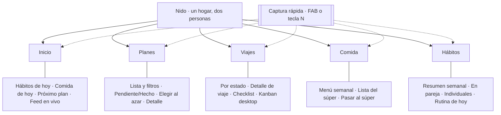
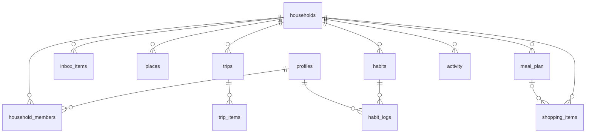
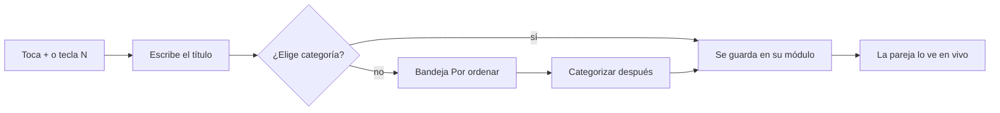

# Nido — Arquitectura de información, datos y flujos

> Copia versionada del documento de arquitectura. Diseño: [Figma — Nido](https://www.figma.com/design/gkBKuDvfp9f6zXI09ab70x)

## Resumen

Nido es una PWA mobile-first para dos personas que comparten un solo espacio de datos ("hogar"), sincronizado en tiempo real con Supabase.

| Decisión | Elección | Por qué |
| --- | --- | --- |
| Frontend | React + Vite + Tailwind CSS v4, PWA instalable | Se instala en iPhone, Android, iPad y desktop sin tiendas |
| Backend | Supabase (Postgres + Auth + Realtime + RLS) | Realtime nativo sobre Postgres, sin servidor propio |
| Estado cliente | TanStack Query + suscripción Realtime por hogar | Caché, updates optimistas y reconciliación simples |
| Deploy | Netlify | Preview por rama/PR para revisar en ambos teléfonos |
| Tokens | Variables de Figma → bloque `@theme` en `src/index.css` | Un cambio en Figma se replica 1:1 en código |

Identidad visual: fondo crema, tarjetas blancas con radio 16 px y sombra suave; tipografía CamingoCode (Fira Code como respaldo). Persona A = coral, Persona B = verde azulado, Juntas = ámbar.

## Arquitectura de información

| Pantalla | Qué muestra | Acción principal |
| --- | --- | --- |
| Inicio | Hábitos de hoy, comida del día, próximo plan, feed de la pareja | Marcar hábito |
| Planes | Tarjetas por etiqueta (Cafés, Restaurantes, Actividades, Películas/Series, Otros) y estado | Elegir al azar / marcar Hecho |
| Viajes | Destinos por estado (Idea, Planeando, Confirmado, Realizado) | Abrir detalle y avanzar estado |
| Detalle de viaje | Fecha tentativa, presupuesto, notas, checklist de imperdibles | Marcar imperdible |
| Comida · Menú | Semana con desayuno, comida, cena y snacks; quién cocina | Asignar platillo |
| Comida · Súper | Lista por categoría con casillas en vivo | Marcar en tienda |
| Hábitos | % semanal por persona, racha en pareja, cuadrícula L–D | Marcar casilla propia |
| Captura rápida | Hoja inferior con un campo y categorías opcionales | Guardar en menos de 5 s |

## Esquema de base de datos

SQL completo: [`supabase/migrations/20261124000000_esquema_inicial.sql`](../supabase/migrations/20261124000000_esquema_inicial.sql)

- Columnas comunes en tablas de módulo: `id, household_id, created_by, created_at, updated_at, deleted_at, client_id`.
- Hábitos: individual = una fila de `habit_logs` por persona y día; en pareja = cualquiera marca y cuenta para las dos.
- Rachas y % semanal: vista SQL (fase 4), no se guardan.
- Hogar: `create_household()` y `join_household(código)`; máximo 2 personas.

## Sincronización en tiempo real

| Pieza | Cómo se resuelve |
| --- | --- |
| Seguridad (RLS) | `is_member(household_id)` en todas las tablas de módulo |
| Cambios de datos | Canal `household:{id}` con `postgres_changes` filtrado por `household_id=eq.{id}` |
| Borrados | Soft delete (`deleted_at`): Realtime no filtra eventos DELETE |
| Presencia | Realtime Presence en el mismo canal: avatares "en línea" |
| Efectos efímeros | Broadcast: destello en la tarjeta que la otra está editando |
| Escritura optimista | TanStack Query `onMutate`; `client_id` para ignorar el propio eco |
| Conflictos | Last-write-wins por fila (`updated_at` por trigger) |
| Orden manual | Columna `position` texto con índice fraccional |
| Offline | Cola de mutaciones en IndexedDB; refetch al reconectar |

## Flujo principal: captura rápida

## Plan por fases

1. **Base:** Vite + Tailwind con tokens, Supabase Auth (magic link), hogar e invitación por código, layout con barra inferior y FAB.
2. **Captura rápida + Planes:** `inbox_items`, `places`, filtros, Pendiente/Hecho, Elegir al azar.
3. **Comida:** menú semanal, súper en tiempo real, pasar ingredientes al súper.
4. **Hábitos:** registro individual y en pareja, rachas y % semanal.
5. **Viajes:** tarjetas por estado, detalle con checklist, kanban con drag & drop en desktop.
6. **Pulido:** offline, notificaciones push (iOS 16.4+ instalada en inicio), modo oscuro.
